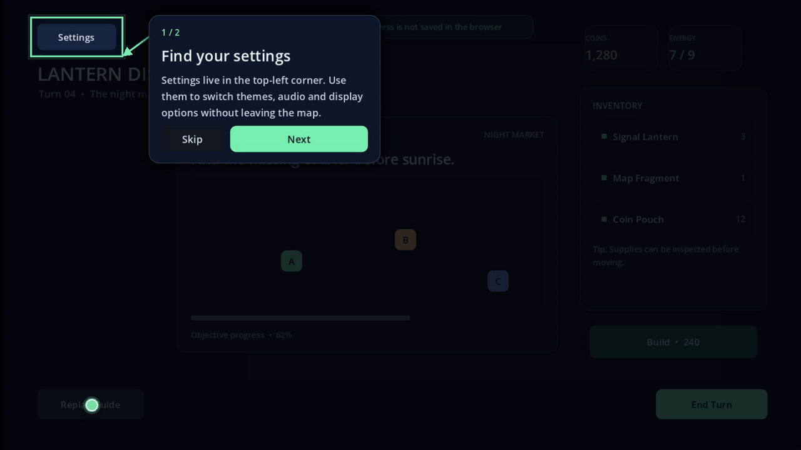

# Godot Spotlight Guide

[](https://github.com/ico-123/godot-spotlight-guide/actions/workflows/ci.yml)

Free, open-source, resource-driven onboarding and spotlight guidance for
Godot 4 UI controls.



Spotlight Guide lets you create polished in-game tutorials without building a
custom overlay for every project. Define steps as resources, point each step at
a `Control`, and the addon handles the dimmed background, focus cutout,
callout, arrow, navigation and completion state.

## Features

- Inspector-editable `SpotlightGuide_Step` and `SpotlightGuide_Sequence`
  resources
- Automatic dimming, focus outline, callout placement and connector arrow
- Next, finish, skip and replay flows
- Optional game pause and full-screen input blocking
- Automatic callout and target tracking after viewport resizing
- `ConfigFile` completion persistence
- Completion signals for integrating with an existing save system
- Safe in-memory fallback when persistence is disabled or unavailable
- Namespaced public API and project conflict warnings
- Runnable five-step desktop demo and restricted two-step browser demo

## Requirements

- Godot 4.7.2 stable or newer in the 4.x series
- `Control` targets in the same canvas coordinate space as the guide overlay

The project is developed and tested with Godot 4.7.2 stable. Other Godot 4.x
versions are expected to work but have not yet been part of the automated test
matrix.

## Installation

### Use the included demo project

1. Download or clone this repository.
2. Open the project directory in Godot 4.7.2 or newer.
3. Press `F5`.

### Add it to an existing project

1. Copy `addons/spotlight_guide` into your project's `addons/` directory.
2. Open **Project Settings > Plugins** and enable **Spotlight Guide**.
3. Add a `SpotlightGuide_Overlay` node to the scene that owns the tutorial.
4. Create a `SpotlightGuide_Sequence` and one or more `SpotlightGuide_Step`
   resources.
5. Assign the sequence to the overlay and set `target_root_path`.
6. Call `guide.start()` when the game is ready to show the guide.

See [docs/INSTALL.md](docs/INSTALL.md) for the detailed setup and
[docs/USAGE.md](docs/USAGE.md) for the complete API and resource reference.

## Minimal setup

```gdscript
@onready var guide: SpotlightGuide_Overlay = $SpotlightGuideOverlay

func show_tutorial() -> void:
	guide.start()

func replay_tutorial() -> void:
	guide.reset_saved_progress()
	guide.start()
```

Each step stores a target node path. With this tree:

```text
GameUI
├── SettingsButton
└── TutorialOverlay
```

Set the overlay's `target_root_path` to `../GameUI` and the step's
`target_path` to `SettingsButton`.

## Signals

```gdscript
guide.step_changed.connect(_on_step_changed)
guide.step_completed.connect(_on_step_completed)
guide.guide_finished.connect(_on_guide_finished)
guide.guide_skipped.connect(_on_guide_skipped)
```

`step_completed` is the recommended bridge for integrating tutorial progress
with a project-specific save system.

## Compatibility and limitations

- Supported target type: `Control`
- `Node2D`, camera-space targets and multiple canvas-layer transforms are not
  supported in 1.0.0
- The built-in progress file is convenient for prototypes; production projects
  can connect the signals to their own save system
- The repository includes only code and demo assets created for this project;
  the Godot engine remains under its own license

## Development

Run the automated smoke test:

```powershell
godot --headless --path . --script res://tests/smoke_test.gd
```

Build a clean desktop package:

```powershell
.\tools\package.ps1 -Version 1.0.0
```

Build the Web demo:

```powershell
.\tools\package_web.ps1 -Version 1.0.0 `
	-GodotExecutable "C:\path\to\Godot_v4.7.2-stable_win64_console.exe"
```

The packaging scripts validate archive contents and write SHA-256 checksums.

## Contributing and security

See [CONTRIBUTING.md](CONTRIBUTING.md) for the development workflow and
[SECURITY.md](SECURITY.md) for responsible vulnerability reporting.

## License

Godot Spotlight Guide is available under the [MIT License](LICENSE.txt). You may
use, modify, redistribute and sell games or tools that include it. No payment,
attribution in a game credits screen or commercial seat is required.

Godot is a trademark of the Godot Engine contributors. This project is not
affiliated with or endorsed by the Godot Engine project.
